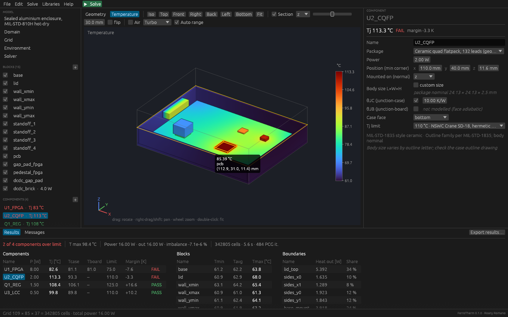
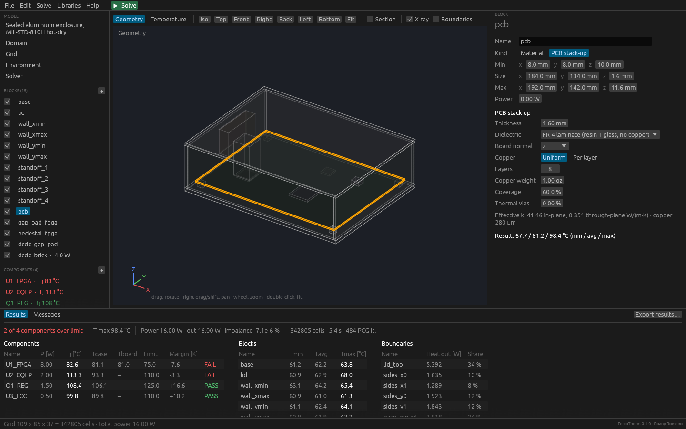

# FerroTherm

**Open-source thermal solver for electronics enclosures, written in Rust.**
Author: **Roany Romano** · License: MIT OR Apache-2.0 · Windows, macOS, Linux

FerroTherm aims to become a free alternative to commercial electronics-cooling
tools. This is **Phase 0**: a validated 3D conduction engine with the
libraries and checks an electronics thermal engineer needs every day. Fluid
flow (CFD) comes in Phase 1.

> 🇮🇹 **In breve:** solutore termico 3D a volumi finiti per contenitori
> elettronici. Fase 0: conduzione stazionaria e transitoria, convezione e
> irraggiamento al contorno, modelli compatti 2R dei componenti con verifica
> del derating Tj (NSWC Crane SD-18), libreria materiali con riferimenti alle
> specifiche MIL/AMS/ASTM/IPC, ambienti MIL-STD-810H, modello PCB a strati.
> Interfaccia grafica desktop (Windows/macOS/Linux) con editor del modello,
> vista 3D, sezioni e mappe di temperatura; anche da riga di comando.
> Risultati in ParaView (VTK) e report Markdown/JSON.



## What it does (Phase 0)

| Area | Capability |
|---|---|
| Physics | Steady and transient 3D heat conduction; orthotropic materials; convection and grey-body radiation boundary conditions (patchable to regions of a face); uniform volumetric sources |
| Numerics | Finite volumes on a non-uniform Cartesian grid that conforms to every geometry plane; harmonic-mean face conductances; MIC(0)-preconditioned conjugate gradient (multithreaded); Picard iterations for radiation; implicit Euler in time |
| Components | 2-resistor compact models (θJC / θJB) with junction node; Tj, Tcase, Tboard and heat split reported; pass/fail against derating limits |
| PCB | Layered effective-conductivity model (copper layers, coverage, thermal vias); boards are automatically resolved with ≥ 4 cells through the thickness |
| Libraries | 35 materials, 9 surface finishes, 18 packages, MIL-STD-810H environments, SD-18 Tj derating rules — every entry with its source; extendable with your own JSON |
| Output | VTK RectilinearGrid (`.vtr`, `.pvd` series) for ParaView; `report.md`, `report.json`, `junctions.csv`; global energy balance |
| Desktop app | Model tree + property editor, 3D view (orbit/pan/zoom, X-ray, section plane, hover probe, click-to-select), background solve with progress and cancel, temperature maps, PASS/FAIL tables, Tj(t) chart, undo/redo, library browser |

## Desktop app

```bash
cargo run --release -p ferrotherm-gui            # opens the example model
cargo run --release -p ferrotherm-gui my_box.toml
```

Release builds ship `ferrotherm-gui.exe` (Windows), `FerroTherm.app` (macOS)
and `ferrotherm-gui` (Linux). The macOS app is ad-hoc signed, not notarised:
the first time, right-click it and choose *Open*.

- **Left:** model tree. `+` adds blocks, components and boundaries; the
  checkbox hides a block in the 3D view. Later items overwrite earlier ones
  where they overlap.
- **Right:** properties of the selected item. Hover any material, package or
  limit for its values and source.
- **Centre:** 3D view. Drag to rotate, right-drag (or Shift+drag) to pan,
  wheel to zoom, double-click to fit, click to select. *Section* cuts the
  model along x, y or z; *X-ray* shows the inside; *Boundaries* shows where
  each boundary condition applies.
- **Solve (F5)** runs in the background (progress bar, *Cancel*). The view
  switches to the temperature map; hover for the local temperature. The
  bottom panel lists Tj with PASS/FAIL, block temperatures and the heat
  leaving through each boundary. *Export results…* writes the VTK files and
  reports.
- Shortcuts: Ctrl/Cmd+N, O, S, Shift+S, Z (undo), Y (redo), D (duplicate),
  Del (delete), Esc (deselect).

The app saves plain case files (`.toml`), identical to the ones the CLI
reads; comments in a hand-written file are not preserved when saved from the
app. The 3D view is drawn by a small depth-buffered software rasteriser, so
it does not depend on the graphics driver; set `FERROTHERM_RENDERER=glow` to
force the OpenGL window backend if the default one fails to start.



## Command line

```bash
# build (needs the Rust toolchain: https://rustup.rs)
cargo build --release

# list what is in the libraries
./target/release/ferrotherm materials
./target/release/ferrotherm materials --category metal
./target/release/ferrotherm packages
./target/release/ferrotherm finishes
./target/release/ferrotherm environments
./target/release/ferrotherm deratings

# effective conductivity of an 8-layer board
./target/release/ferrotherm pcb --thickness 1.6 --layers 8 --oz 1 --coverage 0.6

# create, check and solve the example case
./target/release/ferrotherm init my_box.toml
./target/release/ferrotherm check my_box.toml
./target/release/ferrotherm run my_box.toml
```

On Windows the binary is `target\release\ferrotherm.exe`. Open the `.vtr`
(steady) or `.pvd` (transient) file in [ParaView](https://www.paraview.org).
`ferrotherm run` exits with code **2** when a component exceeds its Tj limit,
so it can gate a CI pipeline.

## Case file

Plain TOML; units are mm, °C, W, W/(m² K), s. See
[`docs/case-format.md`](docs/case-format.md) and
[`examples/mil_enclosure.toml`](examples/mil_enclosure.toml).

```toml
[domain]
min = [0, 0, 0]
max = [200, 150, 60]
material = "air-still"

[environment]
preset = "mil-std-810h-a1-hot-dry"   # 49 °C operational ambient
use = "ambient_max"

[[blocks]]
name = "pcb"
min = [8, 8, 10]
max = [192, 142, 11.6]
pcb = { thickness_mm = 1.6, layers = 8, copper_oz = 1.0, coverage = 0.6 }

[[components]]
name = "U2_CQFP"
package = "cqfp-132"
position = [110, 40, 11.6]
power_w = 2.0
r_jc = 10.0
derating = "sd18-hermetic-normal"

[[boundaries]]
face = "zmax"
type = "convection"
h = 6.0
finish = "al-anodize-black"
```

## Verification

`cargo test --release` runs the analytical verification suite
(`crates/ferrotherm-core/tests/validation.rs`):

| Test | Reference | Result |
|---|---|---|
| Two-layer wall, fixed T + convection | Exact series-resistance solution | error < 1e-6 K (scheme is exact) |
| Slab with uniform generation | T = T0 + q'''x(L−x)/2k | observed order of accuracy 2.00 |
| Transient plane wall, Fo = 0.2 | Fourier series solution | max error 0.13 K on a 100 K step |
| Black-body radiating cube | P = εσA(T⁴ − Tr⁴) | error 0.6 mK |
| 2R compact component | Tj − Tcase = Q·Rjc | exact; power fully accounted |
| Cold-plate patch | Heat balance + 1D estimate | all heat through the patch |

Every run reports the global energy balance (power in vs heat out and
storage). Grid study on the example case (342k → 2.1M cells): junction
temperatures change by less than 0.4 K between 2 mm and 1 mm cells.

## Limitations (read before use)

- **No fluid flow yet.** Internal air only conducts. For sealed boxes this is
  conservative; for fan-cooled or vented equipment the results are not valid.
  External convection is a user-supplied h.
- **Radiation** is surface-to-ambient only; no internal surface-to-surface
  exchange and no solar load.
- **PCB** is an effective (smeared) orthotropic block: individual traces,
  planes and local via arrays under a component are not resolved. Model a
  local copper pour or via field as its own block if it matters.
- **Compact models** are 2R. They are boundary-condition dependent by
  construction; use DELPHI/detailed models for critical parts (Phase 2).
- Library values are **typical handbook values**. Commercial-part θ values
  are deliberately *not* defaulted: they must come from the datasheet.
  MIL-HDBK-217F θJC defaults are provided for ceramic packages because the
  handbook defines them for exactly that use.
- Constant properties (no k(T)).

## Roadmap

1. **Phase 1** — incompressible Navier–Stokes + Boussinesq, conjugate heat
   transfer, validated on De Vahl Davis cavity and heated-block channel cases.
2. **Phase 2** — LVEL turbulence, fans (P–Q curves), porous grilles/filters,
   DELPHI compact models, k(T).
3. **Phase 3** — surface-to-surface radiation, GPU kernels (wgpu), ECAD
   import (ODB++/IPC-2581/IDF), STEP import, GUI.

## Library sources

Each library entry carries a `source` field and, where relevant, the
procurement specification (`specs`). Main references:

- Material properties: ASM Handbook Vol. 2, MatWeb, Ioffe Institute NSM
  database (semiconductors), Incropera (air), supplier typical values.
- θJC defaults: MIL-HDBK-217F Notice 2, section 5.11.
- Tj derating: NAVSEA NSWC Crane SD-18, Microcircuits Derating.
- Climatic design types: MIL-STD-810H, Method 501.7, Table 501.7-I.

Check the current revision of each standard before using results for
qualification. Contributions with better-sourced data are very welcome.

## Project layout

```
crates/ferrotherm-core   numerical engine + libraries (data/*.json)
crates/ferrotherm-cli    `ferrotherm` command-line tool
crates/ferrotherm-gui    `ferrotherm-gui` desktop app (egui/eframe)
examples/                example cases
docs/                    case-file reference
.github/workflows        CI on Windows/macOS/Linux, release binaries on tags
```

## License

Copyright © 2026 Roany Romano. Licensed under either of
[Apache License 2.0](LICENSE-APACHE) or [MIT](LICENSE-MIT) at your option.
Unless you explicitly state otherwise, any contribution intentionally
submitted for inclusion in this work shall be dual licensed as above,
without any additional terms or conditions.
