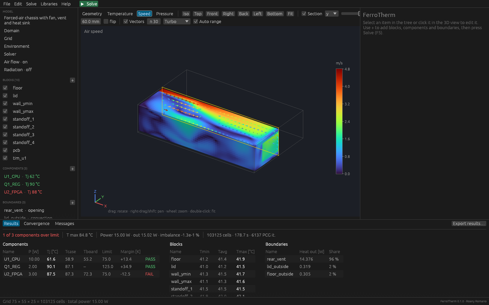
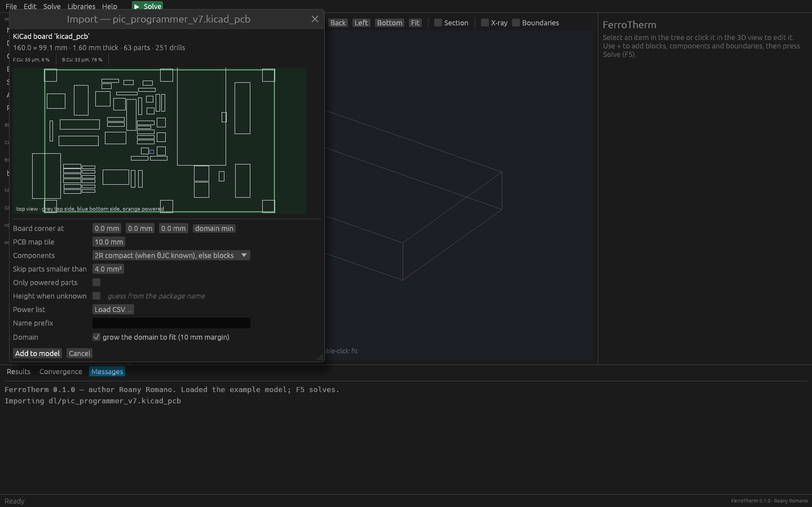
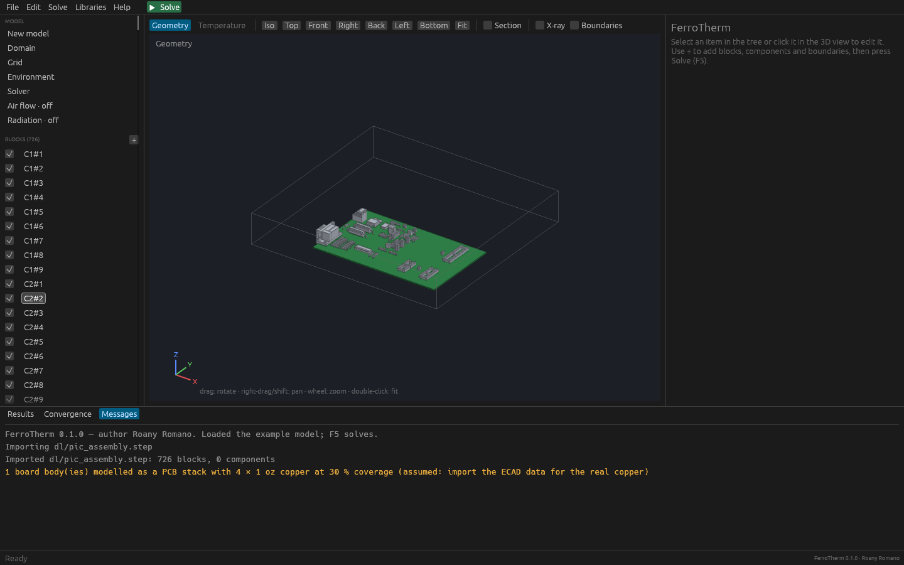

# FerroTherm

**Open-source thermal and air-flow solver for electronics, written in Rust.**
Author: **Roany Romano** · License: MIT OR Apache-2.0 · Windows, macOS, Linux

FerroTherm is a free tool in the spirit of commercial electronics-cooling
solvers (Cadence Celsius EC Solver, Simcenter Flotherm, Icepak): a
conjugate heat-transfer solver on a structured Cartesian grid, compact
component models, fans, vents, grilles and heat sinks, a desktop app and
import of the CAD data an electronics engineer actually has (STEP from
mechanics, IDF/ODB++/IPC-2581/KiCad/Gerber from the board). It is **not** a
clone of any commercial code and it is **not** certified: see the
limitations below.

> 🇮🇹 **In breve:** solutore termofluidodinamico 3D (Navier–Stokes
> incomprimibile con galleggiamento di Boussinesq, turbolenza LVEL o k-ε,
> conduzione coniugata nei solidi) per apparati elettronici. Ventole con
> curva P–Q, aperture e griglie con perdite di carico, dissipatori alettati,
> irraggiamento interno superficie-superficie, carico solare, conducibilità
> k(T), modelli compatti 2R e DELPHI multi-nodo con verifica del derating Tj
> (NSWC Crane SD-18), librerie di materiali/finiture/package con riferimenti
> MIL/AMS/ASTM/IPC, ambienti MIL-STD-810H. Importa STEP (tramite
> OpenCascade, con editor di semplificazione: chiusura fori, rimozione di
> boss, raccordi, smussi e viteria), STL, IDF 3.0, KiCad, Gerber+Excellon,
> IPC-2581, ODB++ e modelli Cadence Celsius EC Solver; schede di forma
> qualsiasi (contorno poligonale con asole);
> esporta STEP, STL, IDF, VTK (ParaView) e CSV. Interfaccia grafica desktop
> per Windows/macOS/Linux e riga di comando.
>
> 📘 **[Guida completa in italiano](docs/guida-italiano.md)** — installazione e
> tutorial passo-passo (scheda in contenitore sigillato, apparato ventilato
> con CFD, import STEP).



## Capabilities

| Area | What is implemented |
|---|---|
| Flow (CFD) | Steady and transient incompressible Navier–Stokes, finite volumes on a staggered Cartesian grid, SIMPLEC pressure–velocity coupling, power-law or upwind convection, Boussinesq buoyancy, conjugate heat transfer (fluid = domain fill, blocks = solids) |
| Turbulence | LVEL (wall distance from a Poisson equation + Spalding law of the wall, turbulent Prandtl 0.9), standard k–ε (Launder & Spalding) with scalable log-law wall functions for momentum and heat (Jayatilleke) and buoyancy production, or laminar |
| Flow devices | Fans with datasheet P–Q curve (operating point found by the solver) or fixed flow, round with hub or rectangular, in the wall or inside the box; openings (vents) at ambient pressure; fixed-flow inlets; symmetry planes; planar resistances (grilles, perforated plates, filters) with quadratic + laminar loss; parametric plate-fin heat sinks |
| Heat transfer | Orthotropic conduction, temperature-dependent k(T), convection and grey radiation boundaries, imposed heat flux and solar load, internal surface-to-surface radiation (Monte Carlo view factors, radiosity) |
| Components | 2-resistor (θJC/θJB) and DELPHI-style multi-node compact models (top/bottom inner/outer, sides, leads); Tj, case and board temperatures, heat split per surface; PASS/FAIL against SD-18 derating or a user limit |
| PCB | Layered effective-conductivity stack; from ECAD data the board becomes a map of tiles, each with the copper coverage of every layer and the plated-via fraction measured from the artwork; any board shape (polygon outline with cut-outs, also on blocks in general) |
| Solvers | BiCGSTAB/PCG with additive-correction multigrid; relative residuals plus a "temperatures settled" convergence check on junctions and monitor points; exact global energy balance reported |
| CAD import | STEP AP203/214/242 (B-rep imported and tessellated by OpenCascade 8, compiled to WebAssembly, with assembly names and placements), STL, IDF 3.0, KiCad `.kicad_pcb` (v5–v9), Gerber X2/RS-274X + Excellon (+ job file), IPC-2581, ODB++ (folder or `.tgz/.zip`, `.Z` files), power list CSV; complete **Cadence Celsius EC Solver** models (`.equipment`: chassis, environment, materials with surface emissivity, radiation settings, PCBs in any 90° orientation with their parts, 2R components, heat sinks, obstructions and CAD solids; "Detailed" packages split into body, die, substrate…; rack models: fans and vents in walls, power supplies, chassis bays with servers in slots, card bays, drive bays, chip and DIMM sockets, heat sinks with cutouts) |
| CAD clean-up | Defeaturing editor on the exact B-rep (OpenCascade `BRepAlgoAPI_Defeaturing`), GUI and CLI: close through/blind/countersunk/counterbored holes, remove bosses, pins and standoffs, fillets and rounds, chamfers; drop small parts (screws, nuts); replace nearly box-shaped parts by their box; names and placements of the assembly kept, simplified STEP saved |
| Fastener removal | Rule-based recognition of screws, washers, nuts, rivets, pins, inserts and standoffs in a STEP assembly (names in five languages, ISO/DIN/UNI standard numbers, thread designations, local shape, part-number family), reviewed in a GUI list or listed by the CLI; the same STEP file is written without the selected parts, every other record byte for byte (header, units, names, colours, PCBs), with a dangling-reference check |
| Export | STEP (AP214 solids), STL, IDF 3.0 board (outline and cut-outs) + library, VTK (`.vtr/.pvd`: temperature, velocity, speed, pressure, material, power density), `report.md/json`, `components.csv`, `blocks.csv`, `junctions.csv` |
| Libraries | 39 materials, finishes, 19 packages (incl. MIL-HDBK-217F θJC defaults), MIL-STD-810H environments, SD-18 derating rules — every entry with its source; extendable with your own JSON |
| Desktop app | Object panel (palette of object types by category, with search and favourites; types not modelled yet shown greyed; a library section that adds a component from any library package or a block of any library material); drag-and-drop from the panel into the 3D view (objects land on the face under the pointer); move / resize handles in the 3D view; a chassis moves and resizes as one object with its own property sheet, model tree and property editors for every object (fans, grilles, heat sinks, monitors, DELPHI networks, flow and radiation settings), 3D view with X-ray and section planes, temperature / air-speed / pressure maps with velocity arrows, live residual plot, CAD import dialog with board preview, undo/redo |

## Desktop app

```bash
cargo run --release -p ferrotherm-gui                                   # example model
cargo run --release -p ferrotherm-gui examples/forced_air_chassis.toml  # CFD example
```

Release builds ship `ferrotherm-gui.exe` (Windows), `FerroTherm.app` (macOS)
and `ferrotherm-gui` (Linux). The macOS app is ad-hoc signed, not notarised:
the first time, right-click it and choose *Open*.

- **Left:** model tree — project, domain, grid, environment, solver, *Air
  flow*, *Radiation*, then blocks, components, boundaries, fans, grilles,
  heat sinks and monitor points (`+` adds one).
- **Right:** properties of the selected item; hover materials, packages and
  limits for their values and sources.
- **Centre:** 3D view (drag rotate, right-drag pan, wheel zoom, double-click
  fit, click select). After a solve: *Temperature*, *Speed*, *Pressure*,
  *Section*, *Vectors*; hover for local values.
- **Bottom:** results tables (PASS/FAIL), *Convergence* (live residuals,
  fans, openings, monitors) and messages.
- **File > Import CAD…** (or drag a file onto the window): STEP/STL become
  blocks (bounding box or voxelised shape); board formats become PCB tiles +
  parts, with a power list CSV (`refdes, power_W [, θJC, θJB, Tj_max]`).
  The first STEP import prepares the OpenCascade kernel (≈30 s once, then
  cached in the user cache folder).
- **File > Export geometry** (STEP, STL, IDF) and **Export results**.





## Command line

```bash
cargo build --release                       # needs Rust ≥ 1.95 (https://rustup.rs)
F=./target/release/ferrotherm

$F run examples/forced_air_chassis.toml     # CFD example
$F cad-info board.kicad_pcb                 # what a CAD file contains
$F import board.kicad_pcb -o box.toml --power power.csv --tile 10
$F import chassis.step --into box.toml --shape voxel:1 --material al-6061-t6
$F import gerbers.zip --into box.toml --origin 10,10,5
$F defeature chassis.step simple.step --holes 8 --fillets 3 --small-parts 50
$F export box.toml box.step                 # also .stl, .emn (IDF)
$F check box.toml
$F run box.toml -o results
$F run box.toml -o results --restart results/box.ftc   # continue a flow solve
$F zoom box.toml --solution results/box.ftc --around U1 --margin 15 --cell 0.5 -o u1.toml   # sub-model
$F materials | packages | finishes | environments | deratings
$F pcb --thickness 1.6 --layers 8 --oz 1 --coverage 0.6
```

A steady flow solve writes its solution to `<output>/<case>.ftc` every 25
iterations (`--checkpoint-every`) and when it stops; `--restart` continues
from it, so a long solve survives an interruption and a solve that stopped
at `max_iterations` can go on. The checkpoint is valid only for the same
geometry and grid.

**Sub-model (zoom-in).** `ferrotherm zoom` cuts a box out of a solved case
(around the blocks whose name starts with `--around`, plus `--margin`, or
`--box`) and writes it as a new case with a finer grid (`--cell`): the
coarse velocities and air temperatures are imposed on the faces of the box,
cut solids keep their coarse temperature, and the face with the largest
outflow is left open. It is the way to resolve fin gaps or a package inside
a model too large for a fine grid everywhere. One-way: the coarse solution
is not corrected, so keep the box faces away from what you want to resolve
(a few centimetres upstream and downstream of a heat sink) and include the
board under the parts.

**Local refinement (nested grids).** A `[refinement]` table in the case
lists regions (around named blocks, or boxes) solved on finer grids of their
own inside the same `ferrotherm run`, coupled both ways with the main grid:
the fine temperatures go back into the main grid with its energy balance
kept, and the fine velocities and pressures as a defect correction of its
momentum equations, so a heat sink the main grid cannot resolve still sets
its share of the flow. Blocks inside the regions are reported from the fine
grids. See `docs/case-format.md`.

`ferrotherm run` exits with code **2** when a component exceeds its Tj
limit and with code **3** when the flow solution did not converge (2 wins when
both apply; the warning is printed anyway), so it can
gate a CI pipeline. A steady flow run stops early only when the key
temperatures have settled *and* the mass and energy residuals are below ten
times `tolerance`. Open the `.vtr` (steady) or `.pvd`
(transient) file in [ParaView](https://www.paraview.org).

## Case file

Plain TOML; units mm, °C, W, W/(m² K), s, m³/s, Pa. Reference:
[`docs/case-format.md`](docs/case-format.md). Examples:
[`examples/mil_enclosure.toml`](examples/mil_enclosure.toml) (sealed MIL box,
conduction) and [`examples/forced_air_chassis.toml`](examples/forced_air_chassis.toml)
(fan, vent, grille, heat sink, CFD).

## Verification

`cargo test --release` runs the verification suites:

| Test | Reference | Result |
|---|---|---|
| Two-layer wall, slab with generation, transient wall, radiating cube, 2R part, cold plate | Analytical | errors ≤ 1e-6 K … 0.13 K, 2nd-order convergence |
| Laminar channel (Poiseuille) | Exact dp/dx and centre velocity | −0.5 % and −0.2 % |
| Differentially heated cavity, Ra = 1e4 / 1e5 | De Vahl Davis (1983) benchmark Nu = 2.243 / 4.519 | 2.259 / 4.559 (+0.7 % / +0.9 %) |
| Fan in a duct with a resistance | Analytic operating point | Q identical to 4 digits |
| Forced convection channel | Energy balance | exact |
| Parallel plates, internal radiation | Analytical radiosity | 7.667 W vs 7.672 W |
| Slab with k(T), plate with solar flux | Analytical | exact |
| DELPHI network reduced to 2R | 2R model | Tj within 0.03 K |
| Real KiCad board vs its own Gerber export | Same board, two readers | copper coverage within 0.04 %; cross-checked with gerbv |
| Real KiCad STEP assembly (55 parts) | Pick-and-place file | 54/54 placed parts at their position |
| Celsius EC Solver model with vertical boards (2024.36) | STEP export of the same model made by Celsius | boards, parts and CAD obstructions within 1e-3 mm |
| Same model solved (sealed conduction-cooled chassis, 3 vertical boards, natural convection + radiation, 18 W; FPBGA "Detailed" packages resolved, Celsius minimum cells, 1.3 M cells) | Temperatures computed by Celsius EC Solver (read from its plot, ±0.3 K) | 2R junctions U1 +0.4 K, U2 −1.1 K; FPGA dies (board 2 / 3) +3.8 / +2.8 K (max), +3.4 / +2.3 K (mean); block parts U3 −1.0, U4 −1.4, U5 −4.4, VR1–VR3 −4.1 … −6.9 K (max of the block). Without the minimum cells the dies are +10 K: grid study of the package alone, die rise 30.5 / 23.3 / 21.6 / 20.5 K at 3.45 / 1 / 0.5 / 0.25 mm |
| Turbulent channel, k–ε + wall functions (H = 20 mm, Re_H ≈ 12 600, wall cells y* ≈ 18…75) | Dean (1978) C_f, Gnielinski (1976) Nu | C_f −11 % (log law alone gives −5 %), Nu +3 … +5 %; grid-independent within 3 % |
| Turbulent channel, k–ω SST with automatic wall treatment (same channel, wall cell from 0.25 to 4 mm, y⁺ ≈ 3 … 50) | Dean friction correlation, Gnielinski Nusselt number | C_f −3.6 / −4.8 / −10.5 %, Nu +5.1 / −0.9 / +0.9 % with 0.25 / 2 / 4 mm cells |
| Laminar channel one cell wide between isothermal plates (g = 2 mm, L = 20 mm, Re ≈ 125) | Stephan's mean Nusselt number for developing flow (Muzychka & Yovanovich 2004) and the same channel with 8 cells across | one cell 0.2890 W, 8 cells 0.2934 W, correlation 0.2938 W of heat to the air (−1.6 %); still air between a hot and a cold plate across one cell: conduction exact (0.10518 W) |
| Sub-model: heated block in a laminar duct on 4 mm cells, then a box around it on 1 mm cells with the coarse flow on its faces | Whole duct on 1 mm cells | block 68.8 °C (fine), 103.1 °C (coarse), **69.6 °C** (sub-model). Rack-tutorial heat sink in a duct, k–ε: 47.5 °C (fine), 53.4 °C (coarse), **48.0 °C** (sub-model, 96 k cells instead of 224 k) |
| Local refinement, same duct: main grid 4 mm, region around the block on 1 mm cells, coupled both ways | Whole duct on 1 mm cells | block 68.8 °C (fine), 103.1 °C (main grid alone), **68.1 °C** (refined, 5 cycles); energy balance closed (imbalance below 0.001 %) |
| Local refinement, two parallel channels, one with a fin array (1 mm fins and gaps, laminar): main grid one cell per gap, region with five | Uniform grid with five cells per gap | share of the flow through the fins 0.135 (fine), 0.172 (main grid alone), **0.142** (refined); fin 182.7 / 173.5 / **181.6 °C** |
| Rack-tutorial heat sink alone in a duct (25 W chip, 18 fins 1 mm, gaps 1.9 mm, k–ε, 2 m/s) | Same case with 3 and 5 cells per fin gap | chip 68.6 °C with one cell per gap before the one-cell-channel model, 53.3 °C with it; 47.5 / 45.8 °C with 3 / 5 cells per gap |
| k–ε, heated block in a duct (3D, conjugate) | Energy balance | imbalance < 0.01 % |
| L-shaped board with a hole (polygon outline) | Exact area, power, export/re-import (STL, IDF with cut-out) | area 5900 mm² exact on a matching grid, all power in the board |
| Celsius "Full Enclosure" rack tutorial (2024.36): 16 blade servers in 4 chassis bays, card bay, power supply, 16 fans, 36 vents | STEP export of the same model made by Celsius | every solid part (16 chips, 16 sockets, 880 heat-sink pieces, 132 sockets, 149 boards, 96 drive pieces, walls), the 16 fans and the 36 vents within 2 µm |
| Same rack solved (1319 W, k–ε, 2.4 M cells with planes closer than 0.9 mm merged, one cell per 1.9 mm fin gap, square fan housings, fan curves as static pressure; converged after restarts: residuals mass 2.3e-5, momentum 1.3e-4, energy 4.9e-3) | Fan operating point and chip temperatures computed by Celsius EC Solver (4.5 M cells; chips read from its plot, ±0.5 K) | rear fans 0.045 m³/s at 92–101 Pa against 0.048 m³/s at 72 Pa (0.037 m³/s at 135 Pa without the outlet dynamic pressure in the curve). Chips U1 48.6 … 53.1 °C (block mean) against 43.8 … 45.3 °C on the rack grid, +4 … +8 K (62.6 … 67.3 °C before the one-cell-channel model). Energy balance closes (1274 W through the openings). Sub-model of the first server's heat sink (box 50 × 141 × 81 mm, 449 k cells, ≈ 3 cells per gap, converged): chip **45.8 °C** against 53.1 °C on the rack grid, within about 1 K of Celsius; the remaining rack-grid error is the fin-gap resolution |
| Same rack with local refinement: 16 regions around the server heat sinks and chips (1.5 × 2.5 × 0.63 mm cells, ≈ 3 cells per gap, 410–445 k cells each), coupled both ways with the 2.4 M-cell main grid, 6 cycles | Same Celsius result | chips U1 **43.6 … 47.0 °C** (block mean, from the fine grids) against 43.8 … 45.3 °C: 12 of 16 within 0.5 K of the Celsius range, the four end servers (S1 of zones 1–2, S4 of zones 3–4) 0.9 … 1.7 K above it. Fans unchanged (0.045 m³/s at 93–103 Pa). Energy balance within 0.8 %. Not fully settled: four regions still changed by 0.4 K in the last cycle, and the last main-grid solve (60 iterations) had not converged |
| Same rack and refinement (3 cycles) after the fan-model fix: curve jump imposed on the fan plane with the local upstream dynamic pressure, closed fan hubs, closed sides on the square fan housings | Same Celsius result | rear fans **0.046 … 0.049 m³/s at 61 … 91 Pa** (eight of ten 0.048 … 0.049 m³/s at 66 … 73 Pa; F15 0.0471 m³/s at 80 Pa) against 0.048 m³/s at 72 Pa. Chips U1 **42.1 … 44.9 °C** (block mean, fine grids) against 43.8 … 45.3 °C: the four end servers 44.2 … 44.9 °C, inside the range; the twelve middle ones 42.1 … 43.0 °C, 0.8 … 1.7 K below it. Last-cycle change ≤ 0.28 K per region. Energy balance within 0.7 %. The main-grid flow does not settle: key temperatures swing 5 … 8 K over 50 iterations, results use time-averaged fields |
| Celsius "Detailed" package (synthetic) | Hand-placed die and substrate | die and substrate at their place in either frame; fallback to one block when the parts fit no frame |
| Defeaturing: plate with through, blind and counterbored holes, a boss, fillets; chassis shell with 12 vents, 4 screw holes and filleted edges; chamfered cover; two-instance assembly | Exact volumes | plain plate 24 000 mm³, shell 48 992 mm³, cover 15 000 mm³ (all exact); instance names and placements kept |
| FerroTherm STEP/IDF/STL export | Re-import (OpenCascade for STEP) | boxes recovered within 1e-4 mm |
| KiCad board → case → solve | Power in = heat out | imbalance < 1e-6 % |

## Limitations (read before use)

- **Not equivalent to a commercial solver.** The numerical method follows
  the same family (structured Cartesian finite volumes, SIMPLE-type coupling,
  LVEL, compact models), but the code is young and validated only on the
  benchmarks above. Compare with measurements or another tool before using
  results for qualification.
- **Turbulence:** LVEL, standard k–ε, k–ω SST or laminar. k–ε with wall
  functions and k–ω SST are meant for forced, fully turbulent flows (fans,
  ducts): on low-Reynolds electronics flows they underpredict the heat
  transfer on coarse grids (heated block at 3 m/s, Re ≈ 5600: block 587 °C
  with k–ε and 514 °C with SST on 2.5 mm cells, 340 / 348 °C on 1 mm cells
  (SST not converged there), against 245 / 302 °C with LVEL; no reference
  solution for this case yet). LVEL stays the default for electronics. The
  SST buoyancy source in the ω equation is left out. Strongly separated or unsteady flows may not
  reach a steady residual; the solver then stops at `max_iterations` and
  reports *NOT converged* — look at the Convergence tab and the monitor
  points, or run transient.
- **Heat sinks need cells in the fin gaps.** The grid is a single
  conforming Cartesian grid (no local refinement yet). A channel one cell
  wide (fin gaps on a coarse grid) gets the laminar parallel-plate shear and
  developing-flow heat transfer (Stephan's correlation), which removes most
  of the error, not all: on the rack-tutorial heat sink the chip is 53.3 °C
  with one cell per gap against 45.8 °C with five (68.6 °C without the
  model). Use at least 3 cells per gap where the heat sink matters; on large
  models this is not affordable until phase 3 of the roadmap.
- **Geometry is axis-aligned boxes** (staircase). STEP bodies are imported
  as bounding boxes or voxels; inclined or curved surfaces are approximated.
  Polygon outlines (boards, blocks) are resolved at the cell centres.
- **Defeaturing** recognises analytic faces (cylinders, cones, tori,
  planes). Spline-only geometry (e.g. a hole exported as B-spline surfaces)
  is not recognised; a removal OpenCascade cannot rebuild is skipped and
  reported, never left broken.
- **CPU only** (multithreaded); no GPU solver yet.
- **IPC-2581 and ODB++** readers are tested on files structured like KiCad's
  exporters and on synthetic samples, not yet on Cadence Allegro / Mentor
  Xpedition / Altium production exports. Please report files that fail.
- **Celsius EC Solver import:** single-axis rotations of boards and
  obstructions (any multiple of 90°), part placement on rotated boards and
  CAD solids inside groups are checked against Celsius' own STEP export.
  Rotations combining several axes, tilted boards and parts rotated on the
  board use conventions not verified yet and are flagged; objects that land
  outside the chassis are listed in the import warnings. "Detailed" packages
  are split into their parts (on the real models the parts are placed from
  the package corner); arrays of solder balls become one equivalent layer.
  Rack models: the conventions (sides, vent and fan offsets, slot
  rotation, sockets, drives) are checked on one Celsius tutorial; the
  power-supply internals are approximated by heated plates, zero-thickness
  bay sides get their thickness inside the bay, TIMs without thickness are
  not modelled (the warning gives the ΔT neglected), card bays with slots
  side by side and parts on the bottom side of a socket are not imported
  yet. A rack has thousands of geometry planes: use `grid.merge_mm` and
  `grid.pcb_cells` to keep the conforming grid affordable.
- **IDF** is imported with board outline, placements and part outlines/heights
  (no copper): combine with Gerber/ODB++ for the copper map.
- Missing part heights are guessed from the package name and listed as a
  warning; library values are typical handbook data; commercial-part θ
  values must come from the datasheet.

## Library sources

Each library entry carries a `source` and, where relevant, the procurement
specification. Main references: ASM Handbook Vol. 2, MatWeb, Ioffe NSM
(semiconductors), Incropera (air, water); MIL-HDBK-217F Notice 2 §5.11 (θJC
defaults); NAVSEA NSWC Crane SD-18 (Tj derating); MIL-STD-810H Method 501.7
(climatic categories); Idelchik, *Flow Resistance*, via Electronics Cooling
(May 1998) for the laminar perforated-plate loss. Check the current revision
of each standard before using results for qualification.

## Project layout

```
crates/ferrotherm-core   numerical engine (conduction, CFD, radiation) + libraries
crates/ferrotherm-io     CAD import/export (STEP via OpenCascade-WASM, STL, IDF,
                         KiCad, Gerber/Excellon, IPC-2581, ODB++, Celsius),
                         STEP defeaturing
crates/ferrotherm-cli    `ferrotherm` command-line tool
crates/ferrotherm-gui    `ferrotherm-gui` desktop app (egui/eframe)
examples/                example cases
docs/                    case-file reference, Italian guide
ROADMAP.md               development phases and what each must validate
```

Third-party: OpenCascade Technology (LGPL-2.1 with exception) is used
through the `occt-wasm` crate as a WebAssembly module run by wasmtime; it can
be left out with `--no-default-features` on `ferrotherm-io` (STEP then falls
back to the built-in reader, which gives vertex bounding boxes only, and
defeaturing is not available).

## License

Copyright © 2026 Roany Romano. Licensed under either of
[Apache License 2.0](LICENSE-APACHE) or [MIT](LICENSE-MIT) at your option.
