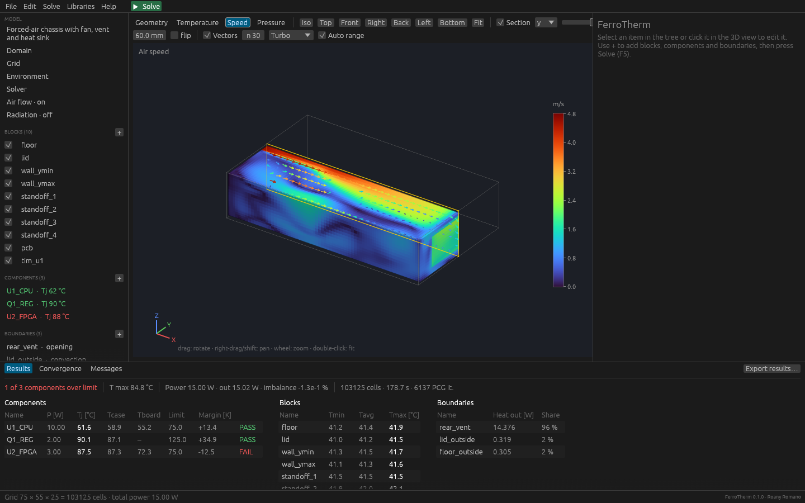
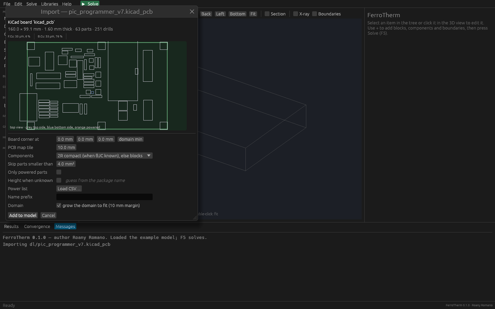
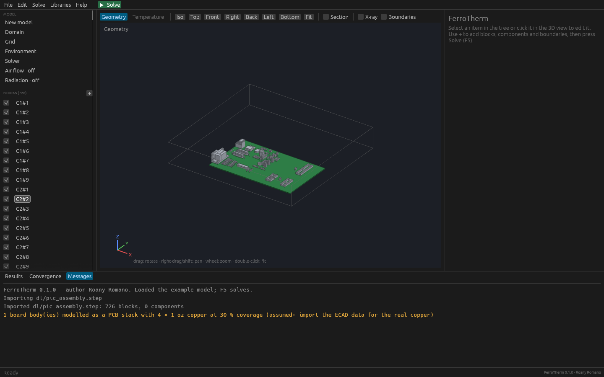

# FerroTherm

**Open-source thermal and air-flow solver for electronics, written in Rust.**
Author: **Roany Romano** · License: MIT OR Apache-2.0 · Windows, macOS, Linux

FerroTherm is a free tool in the spirit of commercial electronics-cooling
solvers (Cadence Celsius EC Solver, Simcenter Flotherm, Icepak): a
conjugate heat-transfer solver on a structured Cartesian grid, compact
component models, fans, vents, grilles and heat sinks, a desktop app and
import of the CAD data an electronics engineer actually has (STEP from
mechanics, IDF/ODB++/IPC-2581/KiCad/Gerber from the board). It is **not** a
clone of any commercial code and it is **not** certified: see the
limitations below.

> 🇮🇹 **In breve:** solutore termofluidodinamico 3D (Navier–Stokes
> incomprimibile con galleggiamento di Boussinesq, turbolenza LVEL,
> conduzione coniugata nei solidi) per apparati elettronici. Ventole con
> curva P–Q, aperture e griglie con perdite di carico, dissipatori alettati,
> irraggiamento interno superficie-superficie, carico solare, conducibilità
> k(T), modelli compatti 2R e DELPHI multi-nodo con verifica del derating Tj
> (NSWC Crane SD-18), librerie di materiali/finiture/package con riferimenti
> MIL/AMS/ASTM/IPC, ambienti MIL-STD-810H. Importa STEP (tramite
> OpenCascade), STL, IDF 3.0, KiCad, Gerber+Excellon, IPC-2581 e ODB++;
> esporta STEP, STL, IDF, VTK (ParaView) e CSV. Interfaccia grafica desktop
> per Windows/macOS/Linux e riga di comando.
>
> 📘 **[Guida completa in italiano](docs/guida-italiano.md)** — installazione e
> tutorial passo-passo (scheda in contenitore sigillato, apparato ventilato
> con CFD, import STEP).



## Capabilities

| Area | What is implemented |
|---|---|
| Flow (CFD) | Steady and transient incompressible Navier–Stokes, finite volumes on a staggered Cartesian grid, SIMPLEC pressure–velocity coupling, power-law or upwind convection, Boussinesq buoyancy, conjugate heat transfer (fluid = domain fill, blocks = solids) |
| Turbulence | LVEL (wall distance from a Poisson equation + Spalding law of the wall, turbulent Prandtl 0.9) or laminar |
| Flow devices | Fans with datasheet P–Q curve (operating point found by the solver) or fixed flow, round with hub or rectangular, in the wall or inside the box; openings (vents) at ambient pressure; fixed-flow inlets; symmetry planes; planar resistances (grilles, perforated plates, filters) with quadratic + laminar loss; parametric plate-fin heat sinks |
| Heat transfer | Orthotropic conduction, temperature-dependent k(T), convection and grey radiation boundaries, imposed heat flux and solar load, internal surface-to-surface radiation (Monte Carlo view factors, radiosity) |
| Components | 2-resistor (θJC/θJB) and DELPHI-style multi-node compact models (top/bottom inner/outer, sides, leads); Tj, case and board temperatures, heat split per surface; PASS/FAIL against SD-18 derating or a user limit |
| PCB | Layered effective-conductivity stack; from ECAD data the board becomes a map of tiles, each with the copper coverage of every layer and the plated-via fraction measured from the artwork |
| Solvers | BiCGSTAB/PCG with additive-correction multigrid; relative residuals plus a "temperatures settled" convergence check on junctions and monitor points; exact global energy balance reported |
| CAD import | STEP AP203/214/242 (B-rep imported and tessellated by OpenCascade 8, compiled to WebAssembly, with assembly names and placements), STL, IDF 3.0, KiCad `.kicad_pcb` (v5–v9), Gerber X2/RS-274X + Excellon (+ job file), IPC-2581, ODB++ (folder or `.tgz/.zip`, `.Z` files), power list CSV; complete **Cadence Celsius EC Solver** models (`.equipment`: chassis, environment, materials with surface emissivity, radiation settings, PCBs in any 90° orientation with their parts, 2R components, heat sinks, obstructions and CAD solids) |
| Export | STEP (AP214 solids), STL, IDF 3.0 board + library, VTK (`.vtr/.pvd`: temperature, velocity, speed, pressure, material, power density), `report.md/json`, `components.csv`, `blocks.csv`, `junctions.csv` |
| Libraries | 39 materials, finishes, 19 packages (incl. MIL-HDBK-217F θJC defaults), MIL-STD-810H environments, SD-18 derating rules — every entry with its source; extendable with your own JSON |
| Desktop app | Model tree and property editors for every object (fans, grilles, heat sinks, monitors, DELPHI networks, flow and radiation settings), 3D view with X-ray and section planes, temperature / air-speed / pressure maps with velocity arrows, live residual plot, CAD import dialog with board preview, undo/redo |

## Desktop app

```bash
cargo run --release -p ferrotherm-gui                                   # example model
cargo run --release -p ferrotherm-gui examples/forced_air_chassis.toml  # CFD example
```

Release builds ship `ferrotherm-gui.exe` (Windows), `FerroTherm.app` (macOS)
and `ferrotherm-gui` (Linux). The macOS app is ad-hoc signed, not notarised:
the first time, right-click it and choose *Open*.

- **Left:** model tree — project, domain, grid, environment, solver, *Air
  flow*, *Radiation*, then blocks, components, boundaries, fans, grilles,
  heat sinks and monitor points (`+` adds one).
- **Right:** properties of the selected item; hover materials, packages and
  limits for their values and sources.
- **Centre:** 3D view (drag rotate, right-drag pan, wheel zoom, double-click
  fit, click select). After a solve: *Temperature*, *Speed*, *Pressure*,
  *Section*, *Vectors*; hover for local values.
- **Bottom:** results tables (PASS/FAIL), *Convergence* (live residuals,
  fans, openings, monitors) and messages.
- **File > Import CAD…** (or drag a file onto the window): STEP/STL become
  blocks (bounding box or voxelised shape); board formats become PCB tiles +
  parts, with a power list CSV (`refdes, power_W [, θJC, θJB, Tj_max]`).
  The first STEP import prepares the OpenCascade kernel (≈30 s once, then
  cached in the user cache folder).
- **File > Export geometry** (STEP, STL, IDF) and **Export results**.





## Command line

```bash
cargo build --release                       # needs Rust ≥ 1.95 (https://rustup.rs)
F=./target/release/ferrotherm

$F run examples/forced_air_chassis.toml     # CFD example
$F cad-info board.kicad_pcb                 # what a CAD file contains
$F import board.kicad_pcb -o box.toml --power power.csv --tile 10
$F import chassis.step --into box.toml --shape voxel:1 --material al-6061-t6
$F import gerbers.zip --into box.toml --origin 10,10,5
$F export box.toml box.step                 # also .stl, .emn (IDF)
$F check box.toml
$F run box.toml -o results
$F materials | packages | finishes | environments | deratings
$F pcb --thickness 1.6 --layers 8 --oz 1 --coverage 0.6
```

`ferrotherm run` exits with code **2** when a component exceeds its Tj
limit and with code **3** when the flow solution did not converge (2 wins when
both apply; the warning is printed anyway), so it can
gate a CI pipeline. A steady flow run stops early only when the key
temperatures have settled *and* the mass and energy residuals are below ten
times `tolerance`. Open the `.vtr` (steady) or `.pvd`
(transient) file in [ParaView](https://www.paraview.org).

## Case file

Plain TOML; units mm, °C, W, W/(m² K), s, m³/s, Pa. Reference:
[`docs/case-format.md`](docs/case-format.md). Examples:
[`examples/mil_enclosure.toml`](examples/mil_enclosure.toml) (sealed MIL box,
conduction) and [`examples/forced_air_chassis.toml`](examples/forced_air_chassis.toml)
(fan, vent, grille, heat sink, CFD).

## Verification

`cargo test --release` runs the verification suites:

| Test | Reference | Result |
|---|---|---|
| Two-layer wall, slab with generation, transient wall, radiating cube, 2R part, cold plate | Analytical | errors ≤ 1e-6 K … 0.13 K, 2nd-order convergence |
| Laminar channel (Poiseuille) | Exact dp/dx and centre velocity | −0.5 % and −0.2 % |
| Differentially heated cavity, Ra = 1e4 / 1e5 | De Vahl Davis (1983) benchmark Nu = 2.243 / 4.519 | 2.259 / 4.559 (+0.7 % / +0.9 %) |
| Fan in a duct with a resistance | Analytic operating point | Q identical to 4 digits |
| Forced convection channel | Energy balance | exact |
| Parallel plates, internal radiation | Analytical radiosity | 7.667 W vs 7.672 W |
| Slab with k(T), plate with solar flux | Analytical | exact |
| DELPHI network reduced to 2R | 2R model | Tj within 0.03 K |
| Real KiCad board vs its own Gerber export | Same board, two readers | copper coverage within 0.04 %; cross-checked with gerbv |
| Real KiCad STEP assembly (55 parts) | Pick-and-place file | 54/54 placed parts at their position |
| Celsius EC Solver model with vertical boards (2024.36) | STEP export of the same model made by Celsius | boards, parts and CAD obstructions within 1e-3 mm |
| Same model solved (sealed conduction-cooled chassis, 3 vertical boards, natural convection + radiation, 18 W) | Temperatures computed by Celsius EC Solver | 2R junctions U1 −1.8 K, U2 −3.1 K; block parts −0.2 … −5.8 K (FerroTherm lower); detailed die not resolved (package lumped into a block) |
| FerroTherm STEP/IDF/STL export | Re-import (OpenCascade for STEP) | boxes recovered within 1e-4 mm |
| KiCad board → case → solve | Power in = heat out | imbalance < 1e-6 % |

## Limitations (read before use)

- **Not equivalent to a commercial solver.** The numerical method follows
  the same family (structured Cartesian finite volumes, SIMPLE-type coupling,
  LVEL, compact models), but the code is young and validated only on the
  benchmarks above. Compare with measurements or another tool before using
  results for qualification.
- **Turbulence:** LVEL or laminar only (no k-ε / k-ω yet). Strongly separated
  or unsteady flows may not reach a steady residual; the solver then stops at
  `max_iterations` and reports *NOT converged* — look at the Convergence tab
  and the monitor points, or run transient.
- **Geometry is axis-aligned boxes** (staircase). STEP bodies are imported
  as bounding boxes or voxels; inclined or curved surfaces are approximated.
- **CPU only** (multithreaded); no GPU solver yet.
- **IPC-2581 and ODB++** readers are tested on files structured like KiCad's
  exporters and on synthetic samples, not yet on Cadence Allegro / Mentor
  Xpedition / Altium production exports. Please report files that fail.
- **Celsius EC Solver import:** single-axis rotations of boards and
  obstructions (any multiple of 90°), part placement on rotated boards and
  CAD solids inside groups are checked against Celsius' own STEP export.
  Rotations combining several axes, tilted boards and parts rotated on the
  board use conventions not verified yet and are flagged; objects that land
  outside the chassis are listed in the import warnings.
- **IDF** is imported with board outline, placements and part outlines/heights
  (no copper): combine with Gerber/ODB++ for the copper map.
- Missing part heights are guessed from the package name and listed as a
  warning; library values are typical handbook data; commercial-part θ
  values must come from the datasheet.

## Library sources

Each library entry carries a `source` and, where relevant, the procurement
specification. Main references: ASM Handbook Vol. 2, MatWeb, Ioffe NSM
(semiconductors), Incropera (air, water); MIL-HDBK-217F Notice 2 §5.11 (θJC
defaults); NAVSEA NSWC Crane SD-18 (Tj derating); MIL-STD-810H Method 501.7
(climatic categories); Idelchik, *Flow Resistance*, via Electronics Cooling
(May 1998) for the laminar perforated-plate loss. Check the current revision
of each standard before using results for qualification.

## Project layout

```
crates/ferrotherm-core   numerical engine (conduction, CFD, radiation) + libraries
crates/ferrotherm-io     CAD import/export (STEP via OpenCascade-WASM, STL, IDF,
                         KiCad, Gerber/Excellon, IPC-2581, ODB++)
crates/ferrotherm-cli    `ferrotherm` command-line tool
crates/ferrotherm-gui    `ferrotherm-gui` desktop app (egui/eframe)
examples/                example cases
docs/                    case-file reference
```

Third-party: OpenCascade Technology (LGPL-2.1 with exception) is used
through the `occt-wasm` crate as a WebAssembly module run by wasmtime; it can
be left out with `--no-default-features` on `ferrotherm-io` (STEP then falls
back to the built-in reader, which gives vertex bounding boxes only).

## License

Copyright © 2026 Roany Romano. Licensed under either of
[Apache License 2.0](LICENSE-APACHE) or [MIT](LICENSE-MIT) at your option.
